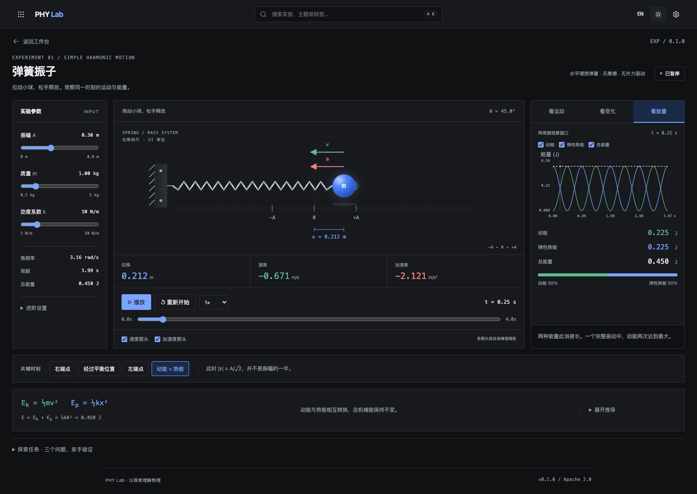

# PHY Lab

纯前端物理实验工作台。通过拖动、参数调整和同步曲线探索物理过程。当前平台版本 **0.1.0**，使用 Apache 2.0 许可证。



面向桌面使用，窗口宽度至少 **1280px**，推荐 **1440px 或更宽**。窄窗口显示桌面尺寸提示。

## 启动

需要 Bun 1.4+、just 和现代浏览器。

```sh
bun install
just dev
```

打开终端显示的本地地址。开发环境不注册离线缓存，方便热更新。

## 使用

首页搜索实验，点击卡片进入。顶部九点菜单可以返回首页；右侧切换中英文、明暗主题或打开设置。

弹簧实验采用三栏实验台：

1. **左侧调参**：调整振幅、质量和劲度系数；角频率、周期和总能量自动计算。展开进阶设置调整初相位。
2. **中央操作**：拉动小球后松手，从静止释放。使用播放、暂停、重新开始和慢速播放；拖动时间游标暂停在任意时刻。位移、速度、加速度显示在场景下方。
3. **右侧观察**：切换“看运动”“看变化”“看能量”，观察共享同一时间的曲线。可以开关曲线，并查看上一轮参数的虚线对比。

下方关键时刻按钮直接定位端点、平衡位置和能量相等位置；公式随观察模式变化。展开“探索任务”验证振幅、加速度和能量周期的问题。

小球也支持键盘：方向键移动，Shift + 方向键大步移动，Home 回到平衡位置，Enter 或空格从静止释放。观察模式支持方向键、Home 和 End 切换。Ctrl/⌘ + K 聚焦实验搜索。

运动轨迹来自真实模型的过去位置采样；箭头按各自峰值缩放，方向与数值保持同步。改变参数会重新开始，并保留上一轮曲线。

蓝色表示位移/势能，绿色表示速度/动能，红色表示加速度。模型为水平理想弹簧、无摩擦、无外力驱动。

## 构建与离线

```sh
just check
just test
just build
just preview
```

生产预览注册 Service Worker。首次资源缓存完成后，设置中显示“可离线使用”，之后可断网打开实验。首次访问仍需网络，浏览器清除站点存储后需要重新缓存。

从设置点击“检查更新”，同时检查平台与实验。平台更新准备完成后点击“保存并更新”，所有标签页保存实验状态后刷新。运行中的实验固定当前构建，实验更新在离开后再次进入时启用。

“清理历史缓存”保留当前平台、目录中的实验和标签页正在使用的资源。语言、主题、实验参数、暂停时间、曲线开关和观察模式使用 LocalStorage 保存。

运行浏览器验收：

```sh
bunx playwright install chromium
just test-browser
just verify
```

`just format` 格式化源码，`just format-check` 检查格式。

## 独立构建

```sh
just build-app
just build-exp spring-oscillator
just catalog
```

平台和实验独立版本、独立发布。新增实验不要求更新平台。全部产物位于 dist；静态托管需 HTTPS、正确的 JS/WASM MIME 类型，并避免将资源 404 重写为首页。

## 文档

- [实施计划](docs/plan.md)
- [设计规范](DESIGN.md)
- [贡献指南](CONTRIBUTING.md)
- [插件协议](docs/plugin-contract.md)
- [发布与更新](docs/release-and-update.md)
- [弹簧模型与操作规则](docs/spring-model.md)

平台采用 Bun、Vite 8、TypeScript 和 Lit Web Components。弹簧实验采用 TypeScript 解析解；复杂计算可在实验自己的 `wasm/` 目录使用 Rust WASM。

## 许可证

[Apache License 2.0](LICENSE)。
