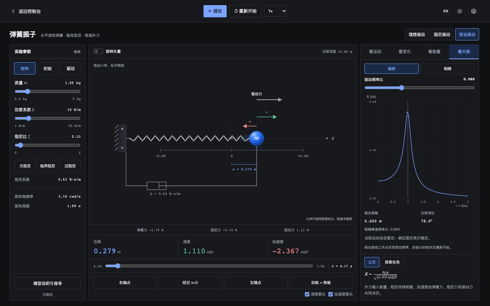
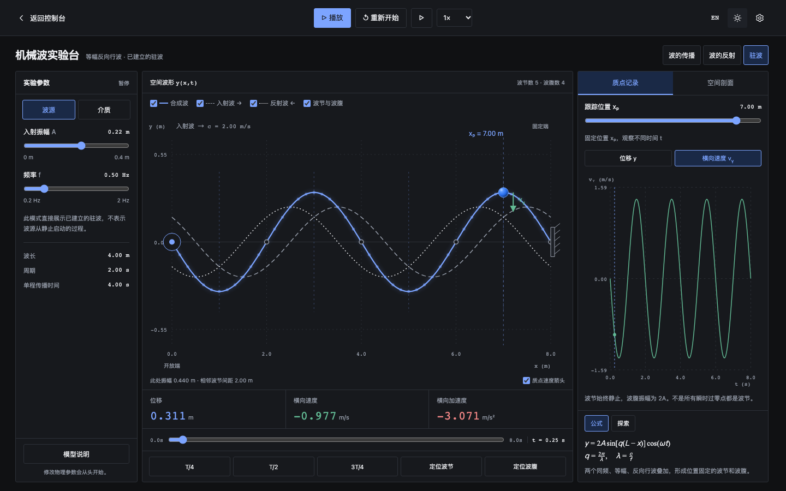
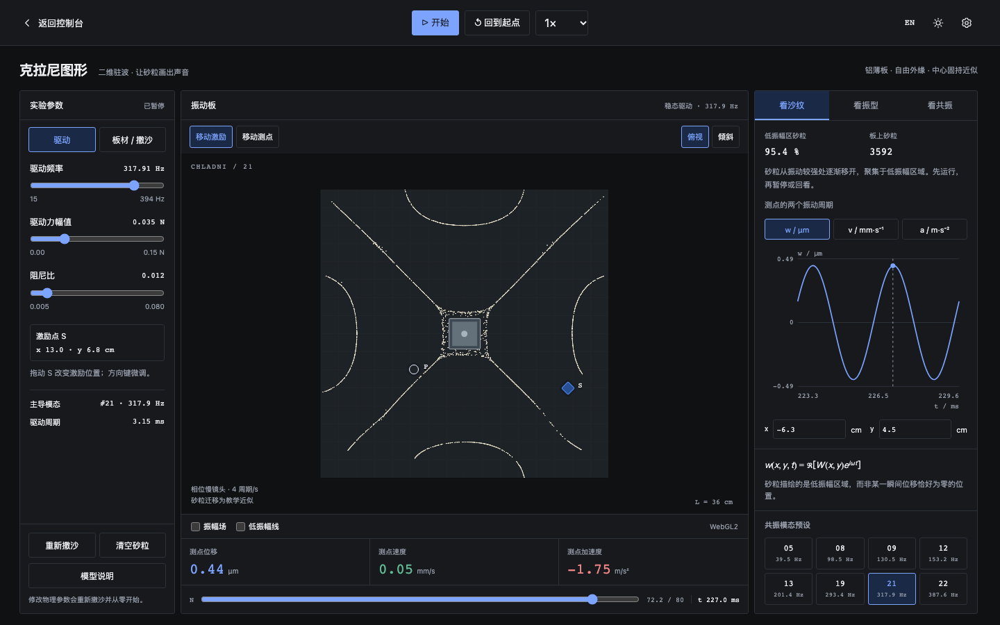
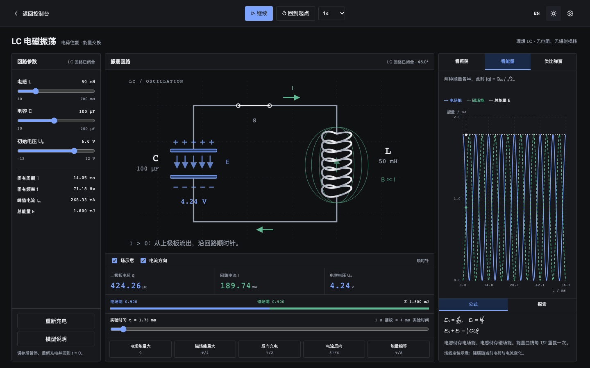

# PHY Lab

纯前端物理实验工作台。通过拖动、参数调整和同步曲线探索物理过程。当前平台版本 **0.1.0**，弹簧振子 **0.2.0**，机械波实验台、克拉尼图形与 LC 电磁振荡均为 **0.1.0**，使用 Apache 2.0 许可证。



面向桌面使用，窗口宽度至少 **1280px**，推荐 **1440px 或更宽**。窄窗口显示桌面尺寸提示。

## 启动

需要 Bun 1.4+、just 和现代浏览器。

```sh
bun install
just dev
```

打开终端显示的本地地址。开发环境不注册离线缓存，方便热更新。同一地址之前运行过生产预览时，开发服务器会自动退出旧 Service Worker 并重新载入开发页面，保留设置和实验状态。

## 使用

首页左侧按单个分类筛选，搜索可同时匹配名称、简介、分类和关键词标签；点击卡片进入。顶部九点菜单可以返回首页；右侧切换中英文、明暗主题或打开设置。设置采用竖向标签布局：外观管理语言和主题，缓存设置显示占用并清理或重新准备离线资源，关于显示平台版本、当前实验及作者和更新入口。实验可通过 metadata 声明自己的设置标签。

弹簧实验保持桌面单屏操作，验收内容区为 **1280×720** 和 **1440×900**（100% 缩放）。标题右侧选择“理想振动”“阻尼振动”或“受迫振动”，三栏分别用于：

1. **左侧调参**：理想模式调整振幅、质量、劲度系数和初相位。阻尼 / 受迫模式按“结构 / 初始 / 驱动”切换参数组，调整阻尼比、初始位移与速度、驱动力和频率比；结构组提供欠阻尼、临界阻尼、过阻尼预设。固有角频率、固有周期和阻尼系数自动计算。
2. **中央操作**：拉动小球后松手，从静止释放。使用播放、暂停、重新开始和慢速播放；拖动时间游标暂停在任意时刻。位移、速度、加速度显示在场景下方。
3. **右侧观察**：切换“看运动”“看变化”“看能量”，观察共享同一时间的曲线。阻尼 / 受迫模式还可查看机械能、累计耗散与外力功的收支；受迫模式增加“看共振”，切换幅频 / 相频图并拖动工作点改变驱动频率。可以开关时间曲线，并查看上一轮参数的虚线对比。

中央时间轴下的关键时刻按钮定位端点、过零点和能量相等时刻。阻尼 / 受迫运动不一定经过所有状态，未找到时会给出说明。右侧底部切换公式与探索任务，完整推导通过左侧“模型说明与推导”弹窗查看，主要操作无需上下滚动。

试着在阻尼模式中比较三种预设的回归过程，再进入受迫模式、保持驱动力不变调整频率比。在“看共振”中寻找振幅峰值，增大阻尼后比较响应高度和相位滞后。响应图描述稳态 / 周期特解，中央运动包含启动暂态；无阻尼精确共振会持续增长，没有有限稳态振幅。图表中的 T₀ 是固有周期，不能当作临界、过阻尼或任意受迫运动的实际重复周期。

理想模式中，场景顶部可开启“旋转矢量”，观察参考圆上端点 M 的水平投影如何对应小球的位置。拖动端点或参考圆边缘可暂停并调整时间；端点支持方向键每次调整 5°、Shift + 方向键调整 15°、Home 定位 0°。关闭辅助图层会保留当前时间、播放状态与画面比例，开关选择自动保存。阻尼 / 受迫模式禁用该图层，返回理想模式恢复偏好。

小球也支持键盘：方向键移动，Shift + 方向键大步移动，Home 回到平衡位置，Enter 或空格从静止释放。观察模式支持方向键、Home 和 End 切换。Ctrl/⌘ + K 聚焦实验搜索。

运动轨迹来自真实模型的过去位置采样；箭头按各自峰值缩放，方向与数值保持同步。改变参数会重新开始，并保留上一轮曲线。大位移时场景自动缩小比例尺并标注范围，物理数值保持真实。

蓝色表示位移/势能，绿色表示速度/动能，红色表示加速度。模型为水平线性弹簧，扩展模式使用黏性阻尼和简谐外力；能量满足“机械能 + 累计耗散 = 初始机械能 + 外力功”。

### 机械波实验台



首页搜索“机械波”进入，在标题旁选择“波的传播”“波的反射”或“驻波”。左栏按“波源 / 介质”调整入射振幅、频率或波包时长、传播速度与观察长度；传播与反射支持向上 / 向下发出单个波包，也可选择连续驱动。反射模式可比较固定端反相、自由端同相。

拖动中央蓝色质点或右侧“跟踪位置”滑块，观察固定位置的位移、横向速度和加速度；质点支持方向键、Shift + 方向键与 Home / End。顶栏播放、慢放，时间轴和关键时刻按钮用于暂停回看。右侧“质点记录”显示一个位置随时间的变化，可切换位移 / 速度；“空间剖面”比较同一时刻的不同位置。点击时间曲线调整时间，点击空间剖面移动探针。

入射波、反射波、合成波和速度箭头可分别隐藏，显示切换保留当前运动状态。驻波提供波节 / 波腹标记、定位按钮和局部振幅；试着点击 `T/4` 后定位波腹，查看绳子瞬间变直时质点是否仍有速度。“探索”提供三个可载入的暂停预设，完整说明位于左下“模型说明”。核心操作保持桌面单屏，修改物理参数会暂停并重新开始。

这里的左边界允许反射波离开，只模拟右端反射；驻波模式直接展示已建立的等幅反向行波叠加。观察长度不是两端固定弦的共振腔长。纵向位移示意放大，坐标和单位保持真实；传播速度 `c` 与质点横向速度 `vᵧ` 含义不同。详细公式与边界约定见 [机械波模型](docs/mechanical-waves-model.md)。

### 克拉尼图形



首页搜索“克拉尼”或“驻波”进入。点击右下共振模态预设，再点击顶栏“开始”，观察砂粒逐渐形成纹路。可以先比较模态 13、21、22。左栏“驱动”调整频率、力幅值与阻尼，“板材 / 撒沙”调整边长、厚度和粒数；改变物理参数或激励位置会暂停、重新撒沙并回到起点。

中央可拖动激励点 S 和测点 P，或先选择移动对象再点击板面；标记支持方向键、Shift 加大步长、Home 回中心。俯视观察沙纹，倾斜观察放大的板面弯曲。右栏切换“看沙纹”“看振型”“看共振”，联动查看测点位移、速度、加速度和频率响应。视角与辅助图层切换保留模拟状态。

顶栏提供播放、暂停、回到起点与慢放，暂停后拖动 N 时间轴回看。“重新撒沙”更换初始分布，“清空砂粒”保留裸板。画面采用明示的相位慢镜头；声音音高始终跟随实际驱动频率，慢放不降调。右上角 **设置 → 实验设置 → 静音** 可关闭声音，选择自动保存；暂停、切后台或离开实验会停止声音。进入或恢复实验时保持暂停，点击播放后才发声。

模型为自由外缘、中心九点位移支承近似的铝薄板，采用预计算弯曲模态的受迫稳态响应。砂粒向低振幅区域迁移属于教学近似；音效用于听辨频率和强弱，不复现真实板面音色。渲染使用原生 WebGL2，不可用时回退到 Canvas 2D 俯视图。操作、公式和适用边界见 [克拉尼模型](docs/chladni-model.md)。

### LC 电磁振荡



首页搜索“LC”进入。左侧调整电感 L、电容 C 和初始电压 U₀，点击“闭合开关”准备观察，或点击顶栏“闭合并运行”开始。电源在振荡前已移除，电容与电感构成独立回路。可以使用负电压反转初始极性；修改参数或“重新充电”会暂停并重新准备初态，“回到起点”保留回路连接状态。

中央联动显示电容极性、电流方向、电场 / 磁场示意、电荷、电流、电压与能量比例。场示意和电流箭头可分别隐藏。下方时间轴支持鼠标与键盘回看四个周期，关键时刻可直接定位电场能最大、磁场能最大、反向充电、电流反向和两种能量相等。物理振荡较快，默认每秒播放推进 **4 ms** 实验时间，还可选择 0.5× / 0.25×；周期和频率始终由 L、C 计算。

右侧切换“看振荡”“看能量”“类比弹簧”，分别观察电荷 / 电流分图、同单位能量曲线及归一化的弹簧运动。上极板电荷为 q，正电流从上极板流出，因此 **I = −dq/dt**；类比中 q 对应位移、−I 对应速度。蓝色表示电荷 / 电场能，绿色表示电流 / 磁场能；能量曲线同时使用不同线型。零初始电压表示未储能，归一化视图会给出说明。

“探索”隐藏右栏图表，展开电压加倍、电感变为四倍和电荷为零三张任务卡片；点击“载入预设”暂停并返回对应图表，点击任意观察标签也能返回。预设统一以 **50 mH、100 μF、6 V** 为基准，参数栏持续显示实际周期、能量或峰值电流的比值。“模型说明”解释符号、时间比例、场线和机械类比。观察切换保留物理状态，核心操作保持桌面单屏。模型为理想 LC，不包含电阻与 RLC 衰减；详细公式和操作规则见 [LC 模型](docs/lc-model.md)。

## 构建与离线

```sh
just check
just test
just build
just preview
```

生产预览注册 Service Worker。首次资源缓存完成后，设置的“缓存设置”中显示“可离线使用”，之后可断网打开实验。首次访问仍需网络，浏览器清除站点存储后需要重新缓存。

从设置的“关于”点击“检查更新”，同时检查平台与实验。平台更新准备完成后点击“保存并更新”，所有标签页保存实验状态后刷新。运行中的实验固定当前构建，实验更新在离开后再次进入时启用。

“清理历史缓存”保留当前平台、目录中的实验和标签页正在使用的资源。语言、主题、实验参数、暂停时间、曲线开关、观察模式和参数分组使用 LocalStorage 保存。弹簧 0.2.0 自动迁移旧理想振动存档，保留旧格式数据以便回滚。机械波与克拉尼使用各自独立的存档，保存测点与图层偏好；克拉尼还保存撒沙种子和静音选择。LC 独立保存参数、开关、时间、倍率、图层、观察与探索偏好。重新进入时暂停。四个实验及全部模式均可在首次完整缓存后离线使用，克拉尼音效也无需联网。

运行浏览器验收：

```sh
bunx playwright install chromium
just test-browser
just verify
```

`just format` 格式化源码，`just format-check` 检查格式。

## 独立构建

```sh
just build-app
just build-exp spring-oscillator
just build-exp mechanical-waves
just build-exp chladni-plate
just build-exp lc-oscillator
just catalog
```

平台和实验独立版本、独立发布。新增实验不要求更新平台。全部产物位于 dist；静态托管需 HTTPS、正确的 JS/WASM MIME 类型，并避免将资源 404 重写为首页。

## 文档

- [实验制作顺序](docs/experiment-roadmap.md)
- [实验制作规范](docs/experiment-guidelines.md)：后续实验的技术、语言、视觉、单屏交互与验收基线。
- [实施计划](docs/plan.md)
- [设计规范](DESIGN.md)
- [贡献指南](CONTRIBUTING.md)
- [插件协议](docs/plugin-contract.md)：v1/v2、修订号与生命周期。
- [公共组件](docs/ui-components.md)：统一控件、公式与表单接入。
- [协议 v2](docs/protocols/v2.md)：API、实验元信息及 dialog 用法。
- [发布与更新](docs/release-and-update.md)
- [弹簧模型与操作规则](docs/spring-model.md)
- [机械波模型与操作规则](docs/mechanical-waves-model.md)
- [克拉尼模型与操作规则](docs/chladni-model.md)
- [LC 模型与操作规则](docs/lc-model.md)

平台采用 Bun、Vite 8、TypeScript 和 Lit Web Components。弹簧、机械波与 LC 使用 TypeScript 解析计算；克拉尼使用预计算薄板模态、TypeScript 稳态响应与砂粒计算，以及原生 WebGL2 / Web Audio。复杂计算可在实验自己的 `wasm/` 目录使用 Rust WASM。

## 许可证

[Apache License 2.0](LICENSE)。
